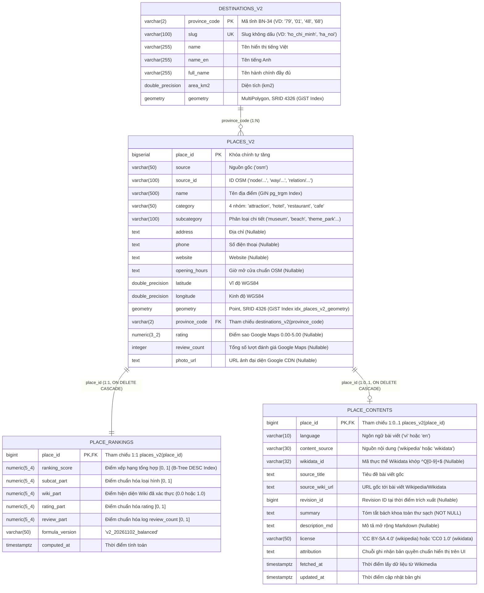

# BACKEND & FRONTEND HANDOFF SPECIFICATION V2: TRAVEL PLANNER DATA SERVICE

> **Ngày cập nhật & xác thực DB**: 2026-11-03 (sau đợt làm giàu `batch_20261102` + cứu dữ liệu 71 danh thắng diện tích lớn `way`/`relation`)  
> **Trạng thái cơ sở dữ liệu**: PostgreSQL 18.6 (PostGIS 3.6.4, `pg_trgm` 1.6) — Đã nạp đầy đủ **4 bảng chính thức** trong schema `analytics`.  
> **Đối tượng sử dụng**: Đội ngũ phát triển **Backend (Java Spring Boot 3.x)** và **Frontend (Next.js 14/15)**. Tài liệu này cung cấp đầy đủ hiện trạng dữ liệu, cấu trúc bảng, truy vấn SQL chuẩn hóa và mẫu JSON thực tế để triển khai ngay mà không cần tìm hiểu nội bộ Data Pipeline.

---

## 1. Tổng quan Hiện trạng Dữ liệu Thực tế (Data Profile & Schema)

### 1.1. Sơ đồ quan hệ thực thể (ERD 4 Bảng trong Schema `analytics`)



---

### 1.2. Thống kê Tổng quan 4 Bảng trong Schema `analytics`

#### A. Bảng `analytics.destinations_v2` — **34 dòng**
- Lưu danh mục 34 tỉnh/thành phố trọng điểm kèm ranh giới hành chính `GEOMETRY(MultiPolygon, 4326)`.
- Top 10 tỉnh/thành phố theo số lượng POI:
  1. **TP. Hồ Chí Minh (`79`, `ho_chi_minh`)**: `6,877` POIs
  2. **Hà Nội (`01`, `ha_noi`)**: `4,631` POIs
  3. **Đà Nẵng (`48`, `da_nang`)**: `4,258` POIs
  4. **Lâm Đồng (`68`, `lam_dong`)**: `2,970` POIs
  5. **Khánh Hòa (`56`, `khanh_hoa`)**: `1,675` POIs
  6. **An Giang (`91`, `an_giang`)**: `1,468` POIs
  7. **Huế (`46`, `hue`)**: `1,095` POIs
  8. **Cần Thơ (`92`, `can_tho`)**: `1,086` POIs
  9. **Hải Phòng (`31`, `hai_phong`)**: `1,007` POIs
  10. **Lào Cai (`15`, `lao_cai`)**: `947` POIs

#### B. Bảng `analytics.places_v2` — **35,516 POIs**

**Phân bố theo 4 `category`:**

| `category` | Số lượng POI | Tỷ lệ (%) | Số POI đã làm giàu (`rating` / `review_count`) | Số POI có `photo_url` | Max `review_count` trong nhóm | Số POI có bài viết Wiki sạch (`place_contents`) | Số POI đủ bộ 3 (`place_contents` + `rating` + `photo_url`) |
| :--- | :---: | :---: | :---: | :---: | :---: | :---: | :---: |
| `restaurant` | `10,600` | `29.85%` | `211` (`1.99%`) | `211` (`1.99%`) | `32,727` | `1` (`0.01%`) | `1` |
| `hotel` | `9,680` | `27.26%` | `280` (`2.89%`) | `280` (`2.89%`) | `17,351` | `15` (`0.15%`) | `5` |
| `cafe` | `8,233` | `23.18%` | `121` (`1.47%`) | `121` (`1.47%`) | `17,143` | `0` (`0.00%`) | `0` |
| `attraction` | `7,003` | `19.72%` | `447` (`6.38%`) | `448` (`6.40%`) | `99,181` | `201` (`2.87%`) | `74` |
| **Tổng cộng** | **`35,516`** | **`100.00%`** | **`1,059` (`2.98%`)** | **`1,060` (`2.98%`)** | **`99,181`** | **`217` (`0.61%`)** | **`80`** |

**Độ phủ các cột thuộc tính (Attribute Coverage) trên `35,516` POIs:**

| Cột thuộc tính | Số dòng khác `NULL` | Tỷ lệ phủ (%) | Hướng dẫn xử lý cho Backend & Frontend |
| :--- | :---: | :---: | :--- |
| `place_id`, `name`, `category`, `latitude`, `longitude`, `province_code` | `35,516` | **`100.00%`** | Luôn khác `NULL`. Sử dụng trực tiếp trên bản đồ và danh sách. |
| `address` | `11,421` | **`32.16%`** | Có thể `NULL`. Nếu `null`, Frontend hiển thị tên tỉnh/thành phố hoặc ẩn dòng địa chỉ chi tiết. |
| `phone` | `4,352` | **`12.25%`** | Có thể `NULL`. Ẩn nút/icon liên hệ điện thoại khi `phone == null`. |
| `opening_hours` | `3,839` | **`10.81%`** | Có thể `NULL`. Chuỗi định dạng OSM (VD: `"Mo-Su 07:30-12:00, 13:30-17:00"`). |
| `website` | `2,166` | **`6.10%`** | Có thể `NULL`. Ẩn liên kết website ngoài khi `website == null`. |
| `photo_url` | `1,060` | **`2.98%`** | Có thể `NULL`. Frontend bắt buộc có bộ ảnh fallback theo từng `category` (`attraction`, `hotel`, `restaurant`, `cafe`) và bắt sự kiện `onError` trên thẻ ``. |
| `rating` & `review_count` | `1,059` | **`2.98%`** | Có thể `NULL`. Không ép kiểu `null` thành `0.0`; khi `rating == null`, hiển thị nhãn `"Chưa có đánh giá"`. |

---

#### C. Bảng `analytics.place_rankings` — **35,516 dòng (`formula_version = 'v2_20261102_balanced'`)**
- **Mục đích**: Lưu điểm xếp hạng hiển thị đã chuẩn hóa trong đoạn $[0, 1]$ cho toàn bộ `35,516` POI (1:1 với `places_v2`).
- **Công thức chính thức (`v2_20261102_balanced`)**:
  $$\text{ranking\_score} = 0.35 \times \text{subcat\_part} + 0.30 \times \text{rating\_part} + 0.25 \times \text{review\_part} + 0.10 \times \text{wiki\_part}$$
  - `subcat_part` ($35\%$): Điểm trọng số loại hình địa điểm (`beach = 1.00`, `theme_park = 1.00`, `museum = 0.95`, `castle = 0.95`, `nature_reserve = 0.90`, `archaeological_site = 0.90`, `viewpoint = 0.70`, `park/monument/attraction = 0.65`, ..., `hotel = 0.45`, `restaurant/cafe = 0.40`).
  - `rating_part` ($30\%$): $\text{rating} / 5.0$ (nếu `rating IS NULL` thì bằng $0.0$).
  - `review_part` ($25\%$): $\ln(1 + \text{review\_count}) / \ln(1 + \max_{\text{category}}(\text{review\_count}))$ (nếu `review_count IS NULL` thì bằng $0.0$).
  - `wiki_part` ($10\%$): $1.0$ nếu địa điểm có bài viết Wikipedia/Wikidata thực sự đã vượt qua bộ lọc kiểm duyệt thực thể (`217` POI); ngược lại bằng $0.0$.
- **Thống kê phân phối điểm `ranking_score` trên `35,516` dòng**:
  - `min`: **`0.0875`** | `p25`: **`0.1400`** | `median (p50)`: **`0.1400`** | `mean`: **`0.1702`** | `p75`: **`0.1575`** | `p90`: **`0.2275`** | `p95`: **`0.2450`** | `p99`: **`0.6430`** | `max`: **`0.9412`**
  - Số dòng có `wiki_part = 1.0`: **`217` dòng** (`0.61%`).
  - Số dòng có `rating_part > 0` (`review_part > 0`): **`1,059` dòng** (`2.98%`).

**Phân phối điểm theo từng `category`:**

| `category` | Tổng số dòng | Số dòng có `rating_part > 0` | Số dòng có `wiki_part = 1.0` | `min` | `median` | `mean` | `p95` | `max` |
| :--- | :---: | :---: | :---: | :---: | :---: | :---: | :---: | :---: |
| `attraction` | `7,003` | `447` | `201` | `0.0875` | `0.2275` | `0.2298` | `0.6056` | `0.9412` |
| `hotel` | `9,680` | `280` | `15` | `0.1575` | `0.1575` | `0.1705` | `0.1575` | `0.7730` |
| `restaurant` | `10,600` | `211` | `1` | `0.1400` | `0.1400` | `0.1489` | `0.1400` | `0.6840` |
| `cafe` | `8,233` | `121` | `0` | `0.1400` | `0.1400` | `0.1465` | `0.1400` | `0.6618` |

---

#### D. Bảng `analytics.place_contents` — **217 dòng bài viết sạch**
- **Hiện trạng**: Đã tạo bảng và nạp thành công **`217` bài viết thực tế** từ Wikipedia REST Summary API và Wikidata API (đã loại bỏ hoàn toàn 21 trường hợp gắn nhầm đơn vị hành chính tỉnh/huyện, nhân vật lịch sử `Q5`, bài ngoại ngữ không có bản `vi/en` hoặc bài rỗng).
- **Thống kê phân bố `217` bản ghi trong `analytics.place_contents`**:
  - **Theo ngôn ngữ (`language`)**:
    - Tiếng Việt (`'vi'`): **`181` bài** (`83.41%`)
    - Tiếng Anh (`'en'`): **`36` bài** (`16.59%`)
  - **Theo nguồn nội dung & giấy phép (`content_source` & `license`)**:
    - `'wikipedia'` (`license = 'CC BY-SA 4.0'`): **`191` bài** (`88.02%`)
    - `'wikidata'` (`license = 'CC0 1.0'`): **`26` bài** (`11.98%`)
  - **Theo danh mục (`category` của POI)**:
    - `attraction`: **`201` bài** (`92.63%`)
    - `hotel`: **`15` bài** (`6.91%`)
    - `restaurant`: **`1` bài** (`0.46%`)
    - `cafe`: **`0` bài** (`0.00%`)

**Cấu trúc DDL chi tiết của bảng `analytics.place_contents`:**

```sql
CREATE TABLE IF NOT EXISTS analytics.place_contents (
    place_id        BIGINT PRIMARY KEY
                    REFERENCES analytics.places_v2(place_id) ON DELETE CASCADE,
    language        VARCHAR(10)  NOT NULL,
    content_source  VARCHAR(30)  NOT NULL,
    wikidata_id     VARCHAR(32),
    source_title    TEXT         NOT NULL,
    source_wiki_url TEXT         NOT NULL,
    revision_id     BIGINT,
    summary         TEXT         NOT NULL,
    description_md  TEXT,
    license         VARCHAR(50)  NOT NULL,
    attribution     TEXT         NOT NULL,
    fetched_at      TIMESTAMPTZ  NOT NULL DEFAULT NOW(),
    updated_at      TIMESTAMPTZ  NOT NULL DEFAULT NOW(),

    CONSTRAINT chk_pc_language_nonempty   CHECK (BTRIM(language) <> ''),
    CONSTRAINT chk_pc_source_title        CHECK (BTRIM(source_title) <> ''),
    CONSTRAINT chk_pc_source_url          CHECK (BTRIM(source_wiki_url) <> ''),
    CONSTRAINT chk_pc_summary             CHECK (BTRIM(summary) <> ''),
    CONSTRAINT chk_pc_attribution         CHECK (BTRIM(attribution) <> ''),
    CONSTRAINT chk_pc_wikidata_id         CHECK (wikidata_id IS NULL OR wikidata_id ~ '^Q[0-9]+$'),
    CONSTRAINT chk_pc_content_source      CHECK (content_source IN ('wikipedia','wikidata')),
    CONSTRAINT chk_pc_source_license      CHECK (
        (content_source = 'wikipedia' AND license = 'CC BY-SA 4.0') OR
        (content_source = 'wikidata'  AND license = 'CC0 1.0')
    )
);
```

---

## 2. Đặc tả Chi tiết 5 RESTful API Endpoints (Spring Boot & Next.js)

> [!IMPORTANT]
> **Nguyên tắc kết nối Database & Kiến trúc cho Backend (Spring Boot 3.x):**
> - **Chiến lược truy vấn (Native Query + DTO Projection)**: Backend không cần cài thêm thư viện Hibernate Spatial/JTS. Áp dụng phương pháp **Spring Data JPA Native Query + Interface-based DTO Projection** (kế thừa đúng mẫu `DestinationProjection` hiện có trong repo) để ánh xạ trực tiếp các hàm PostGIS và trường tính toán sang Java DTO.
> - **Quy ước đặt tên (Naming Convention)**: Toàn bộ alias trong SQL và trường trong JSON Response được đồng bộ chuẩn **`camelCase`** (`provinceCode`, `rankingScore`, `hasContent`, `distanceMeters`, `poiCount`, `bboxMinLat`...) để tương thích tự nhiên với Spring Boot Jackson và Frontend TypeScript (`place.ts`, `trip.ts`).
> - **Cấu hình Connection Pool**: Sử dụng Connection Pool (HikariCP) ở chế độ `read-only: true`.
> - **Quy tắc sắp xếp**: Không tính toán lại điểm xếp hạng ở tầng Java; luôn sử dụng `ORDER BY r.ranking_score DESC, r.review_part DESC, p.place_id ASC`.

---

### Endpoint 1: `GET /api/v1/destinations`
- **Mục đích UI/UX**: Cung cấp danh sách 34 tỉnh/thành phố cho bộ chọn điểm đến (Destination Picker), kèm số lượng địa điểm (`poiCount`), tọa độ tâm (`centerLat`, `centerLon`) và khung bao bản đồ (`bbox`) để Frontend tự động `flyTo` / `fitBounds` khi người dùng chọn tỉnh.
- **Tối ưu hóa hiệu năng (Spring Cache)**: Dữ liệu 34 tỉnh là tĩnh, hàm `ST_PointOnSurface(d.geometry)` và `GROUP BY d.geometry` khá nặng hình học. Khuyến nghị gắn annotation **`@Cacheable("destinations")`** tại Service layer để chỉ truy vấn Database một lần duy nhất lúc khởi động, giảm độ trễ phản hồi xuống `< 5ms`.
- **Tương thích ngược URL**: Controller có thể khai báo `@RequestMapping({"/api/v1/destinations", "/api/destinations"})` để hỗ trợ song song URL cũ và mới.

#### Câu lệnh SQL mẫu tối ưu (Native Query với alias `camelCase`):
```sql
SELECT
    d.province_code AS "provinceCode",
    d.slug,
    d.name,
    d.name_en AS "nameEn",
    d.full_name AS "fullName",
    ROUND(d.area_km2::numeric, 2) AS "areaKm2",
    ROUND(ST_Y(ST_PointOnSurface(d.geometry))::numeric, 6) AS "centerLat",
    ROUND(ST_X(ST_PointOnSurface(d.geometry))::numeric, 6) AS "centerLon",
    ROUND(ST_YMin(d.geometry)::numeric, 6) AS "bboxMinLat",
    ROUND(ST_XMin(d.geometry)::numeric, 6) AS "bboxMinLon",
    ROUND(ST_YMax(d.geometry)::numeric, 6) AS "bboxMaxLat",
    ROUND(ST_XMax(d.geometry)::numeric, 6) AS "bboxMaxLon",
    COUNT(p.place_id) AS "poiCount",
    COUNT(p.place_id) FILTER (WHERE p.category = 'attraction') AS "attractionCount"
FROM analytics.destinations_v2 d
LEFT JOIN analytics.places_v2 p
    ON p.province_code = d.province_code
GROUP BY
    d.province_code, d.slug, d.name, d.name_en, d.full_name, d.area_km2, d.geometry
ORDER BY "poiCount" DESC, d.province_code ASC;
```

#### JSON Response mẫu thực tế:
```json
{
  "total": 34,
  "items": [
    {
      "provinceCode": "79",
      "slug": "ho_chi_minh",
      "name": "Hồ Chí Minh",
      "nameEn": "Ho Chi Minh",
      "fullName": "Thành phố Hồ Chí Minh",
      "areaKm2": 6772.59,
      "center": { "lat": 10.823099, "lon": 106.629664 },
      "bbox": {
        "minLat": 8.5597,
        "minLon": 106.3562,
        "maxLat": 11.4981,
        "maxLon": 107.5124
      },
      "poiCount": 6877,
      "attractionCount": 1018
    },
    {
      "provinceCode": "01",
      "slug": "ha_noi",
      "name": "Hà Nội",
      "nameEn": "Hanoi",
      "fullName": "Thành phố Hà Nội",
      "areaKm2": 3359.84,
      "center": { "lat": 21.028511, "lon": 105.804817 },
      "bbox": {
        "minLat": 20.5645,
        "minLon": 105.2881,
        "maxLat": 21.3853,
        "maxLon": 106.0201
      },
      "poiCount": 4631,
      "attractionCount": 824
    }
  ]
}
```

---

### Endpoint 2: `GET /api/v1/destinations/{provinceSlugOrCode}/recommendations`
- **Mục đích UI/UX**: Phục vụ thanh Carousel **"Địa điểm được đề xuất" (Top 10 - 15)** ngay khi người dùng chọn một tỉnh/thành phố.
- **Query Parameters**:
  - `category` (String, tùy chọn, mặc định `'attraction'`; nhận một trong `'attraction'`, `'hotel'`, `'restaurant'`, `'cafe'` hoặc `'all'`).
  - `limit` (Integer, mặc định `10`, tối đa `50`).
  - `offset` (Integer, mặc định `0`).
- **Điểm nhấn kỹ thuật**: Sử dụng `INNER JOIN analytics.place_rankings` và `LEFT JOIN analytics.place_contents` để trả về cờ boolean `hasContent` (giúp Frontend hiển thị huy hiệu *"Có bài giới thiệu Wiki"* trên thẻ địa điểm).

#### Câu lệnh SQL mẫu tối ưu:
```sql
SELECT
    p.place_id AS "placeId",
    p.name,
    p.category,
    p.subcategory,
    p.address,
    p.latitude,
    p.longitude,
    p.rating,
    p.review_count AS "reviewCount",
    p.photo_url AS "photoUrl",
    r.ranking_score AS "rankingScore",
    (c.place_id IS NOT NULL) AS "hasContent",
    c.language AS "contentLanguage"
FROM analytics.places_v2 p
INNER JOIN analytics.destinations_v2 d
    ON d.province_code = p.province_code
INNER JOIN analytics.place_rankings r
    ON r.place_id = p.place_id
LEFT JOIN analytics.place_contents c
    ON c.place_id = p.place_id
WHERE (d.slug = :provinceSlugOrCode OR d.province_code = :provinceSlugOrCode)
  AND (:category = 'all' OR p.category = :category)
ORDER BY
    r.ranking_score DESC,
    r.review_part DESC,
    p.place_id ASC
LIMIT :limit OFFSET :offset;
```

#### JSON Response mẫu thực tế (`GET /api/v1/destinations/da_nang/recommendations?category=attraction&limit=5`):
```json
{
  "destination": {
    "provinceCode": "48",
    "slug": "da_nang",
    "name": "Đà Nẵng"
  },
  "category": "attraction",
  "limit": 5,
  "offset": 0,
  "items": [
    {
      "placeId": 106510,
      "name": "Bãi biển Mỹ Khê",
      "category": "attraction",
      "subcategory": "beach",
      "address": null,
      "latitude": 16.063783,
      "longitude": 108.246924,
      "rating": 4.7,
      "reviewCount": 4748,
      "photoUrl": "https://lh3.googleusercontent.com/...",
      "rankingScore": 0.9160,
      "hasContent": true,
      "contentLanguage": "vi"
    },
    {
      "placeId": 102052,
      "name": "Sun World Bà Nà Hills",
      "category": "attraction",
      "subcategory": "theme_park",
      "address": null,
      "latitude": 15.997735,
      "longitude": 107.988071,
      "rating": 4.4,
      "reviewCount": 99181,
      "photoUrl": "https://lh3.googleusercontent.com/...",
      "rankingScore": 0.8640,
      "hasContent": false,
      "contentLanguage": null
    },
    {
      "placeId": 103487,
      "name": "VinWonders Nam Hội An",
      "category": "attraction",
      "subcategory": "theme_park",
      "address": null,
      "latitude": 15.792481,
      "longitude": 108.404129,
      "rating": 4.9,
      "reviewCount": 17293,
      "photoUrl": "https://lh3.googleusercontent.com/...",
      "rankingScore": 0.8560,
      "hasContent": false,
      "contentLanguage": null
    },
    {
      "placeId": 106427,
      "name": "Ngũ Hành Sơn",
      "category": "attraction",
      "subcategory": "attraction",
      "address": null,
      "latitude": 16.003382,
      "longitude": 108.263237,
      "rating": 4.4,
      "reviewCount": 43179,
      "photoUrl": "https://lh3.googleusercontent.com/...",
      "rankingScore": 0.8234,
      "hasContent": true,
      "contentLanguage": "vi"
    },
    {
      "placeId": 103025,
      "name": "Cầu Vàng",
      "category": "attraction",
      "subcategory": "attraction",
      "address": null,
      "latitude": 15.995062,
      "longitude": 107.996389,
      "rating": 4.6,
      "reviewCount": 15109,
      "photoUrl": "https://lh3.googleusercontent.com/...",
      "rankingScore": 0.8126,
      "hasContent": true,
      "contentLanguage": "vi"
    }
  ]
}
```

---

### Endpoint 3: `GET /api/v1/places/search`
- **Mục đích UI/UX**: Phục vụ **Ô tìm kiếm Autocomplete (Dropdown)** khi người dùng gõ từ khóa (VD: `"bảo tàng"`, `"bãi trước"`, `"cầu vàng"`).
- **Query Parameters**:
  - `q` (String, bắt buộc, độ dài tối thiểu 2 ký tự).
  - `provinceCode` hoặc `province_code` (String, tùy chọn — lọc trong phạm vi tỉnh đang chọn).
  - `category` (String, tùy chọn — lọc theo nhóm địa điểm).
  - `limit` (Integer, mặc định `10`, tối đa `30`).
- **Điểm nhấn kỹ thuật**: Kết hợp độ tương đồng trigram `similarity(p.name, :q)` (tận dụng GIN index `idx_places_v2_name_trgm`) với điểm xếp hạng `r.ranking_score` theo công thức `0.55 * similarity + 0.45 * r.ranking_score` để các danh thắng nổi tiếng khớp tên luôn đứng đầu danh sách gợi ý thay vì các hộ kinh doanh nhỏ lẻ trùng từ khóa.

#### Câu lệnh SQL mẫu tối ưu:
```sql
SELECT
    p.place_id AS "placeId",
    p.name,
    p.category,
    p.subcategory,
    p.address,
    p.province_code AS "provinceCode",
    d.name AS "provinceName",
    p.latitude,
    p.longitude,
    p.rating,
    p.review_count AS "reviewCount",
    p.photo_url AS "photoUrl",
    r.ranking_score AS "rankingScore",
    ROUND(similarity(p.name, :q)::numeric, 4) AS "textSimilarity",
    ROUND((0.55 * similarity(p.name, :q) + 0.45 * r.ranking_score)::numeric, 4) AS "combinedSearchScore",
    (c.place_id IS NOT NULL) AS "hasContent"
FROM analytics.places_v2 p
INNER JOIN analytics.place_rankings r
    ON r.place_id = p.place_id
INNER JOIN analytics.destinations_v2 d
    ON d.province_code = p.province_code
LEFT JOIN analytics.place_contents c
    ON c.place_id = p.place_id
WHERE (
        p.name ILIKE '%' || :q || '%'
        OR similarity(p.name, :q) >= 0.25
      )
  AND (:provinceCode IS NULL OR p.province_code = :provinceCode)
  AND (:category IS NULL OR p.category = :category)
ORDER BY
    (p.name ILIKE :q || '%') DESC,
    "combinedSearchScore" DESC,
    r.ranking_score DESC,
    p.place_id ASC
LIMIT :limit;
```

#### JSON Response mẫu thực tế (`GET /api/v1/places/search?q=bảo tàng&provinceCode=79&limit=3`):
```json
{
  "query": "bảo tàng",
  "provinceCode": "79",
  "category": null,
  "items": [
    {
      "placeId": 101584,
      "name": "Bảo tàng Chứng tích Chiến tranh",
      "category": "attraction",
      "subcategory": "museum",
      "address": "28, Võ Văn Tần, Ho Chi Minh City",
      "provinceCode": "79",
      "provinceName": "Hồ Chí Minh",
      "latitude": 10.779365,
      "longitude": 106.692281,
      "rating": 4.5,
      "reviewCount": 41595,
      "photoUrl": "https://lh3.googleusercontent.com/...",
      "rankingScore": 0.9336,
      "textSimilarity": 0.3125,
      "combinedSearchScore": 0.5920,
      "hasContent": true
    },
    {
      "placeId": 103590,
      "name": "Bảo tàng Hồ Chí Minh",
      "category": "attraction",
      "subcategory": "museum",
      "address": "1, Nguyễn Tất Thành, Ho Chi Minh City",
      "provinceCode": "79",
      "provinceName": "Hồ Chí Minh",
      "latitude": 10.768241,
      "longitude": 106.706812,
      "rating": 4.7,
      "reviewCount": 2157,
      "photoUrl": "https://lh3.googleusercontent.com/...",
      "rankingScore": 0.8813,
      "textSimilarity": 0.4545,
      "combinedSearchScore": 0.6466,
      "hasContent": true
    },
    {
      "placeId": 106501,
      "name": "Bảo tàng Lịch sử Thành phố Hồ Chí Minh",
      "category": "attraction",
      "subcategory": "museum",
      "address": "2, Nguyễn Bỉnh Khiêm, Ho Chi Minh City",
      "provinceCode": "79",
      "provinceName": "Hồ Chí Minh",
      "latitude": 10.787982,
      "longitude": 106.704754,
      "rating": 4.5,
      "reviewCount": 4214,
      "photoUrl": "https://lh3.googleusercontent.com/...",
      "rankingScore": 0.8839,
      "textSimilarity": 0.2500,
      "combinedSearchScore": 0.5353,
      "hasContent": true
    }
  ]
}
```

---

### Endpoint 4: `GET /api/v1/places/{placeId}`
- **Mục đích UI/UX**: Phục vụ **Modal / Drawer chi tiết địa điểm bên phải bản đồ** khi người dùng click vào một marker hoặc một thẻ trên Carousel.
- **Cấu trúc trả về & Quy tắc hiển thị bản quyền**:
  - Thực hiện `LEFT JOIN analytics.place_rankings` và `LEFT JOIN analytics.place_contents`.
  - **Trường hợp 1 (`content != null` — Địa điểm có bài viết Wikipedia/Wikidata)**:
    - Trả về object `content` chứa đầy đủ: `summary`, `descriptionMd`, `language`, `contentSource`, `wikidataId`, `sourceTitle`, `sourceWikiUrl`, `revisionId`, `license`, `attribution`.
    - **Hướng dẫn Frontend (Bắt buộc pháp lý theo giấy phép CC BY-SA 4.0 / CC0 1.0)**:
      - Hiển thị đoạn văn `content.summary` trong phần **"Giới thiệu / Lịch sử"**.
      - Ngay bên dưới đoạn giới thiệu, hiển thị dòng chữ nhỏ chứa `content.attribution` kèm liên kết ngoài (`<a href={content.sourceWikiUrl} target="_blank" rel="noopener noreferrer">Xem bài gốc trên Wikipedia/Wikidata</a>`).
      - Nếu `content.language == "en"`, có thể hiển thị badge nhỏ `"Tóm tắt tiếng Anh (Wikipedia EN)"` để người dùng biết trước.
  - **Trường hợp 2 (`content == null` — Địa điểm chưa có bài viết Wiki)**:
    - Trả về `"content": null`.
    - **Hướng dẫn Frontend Fallback mượt mà**: Ẩn khối văn bản bách khoa toàn thư (tuyệt đối không hiển thị khung trống hoặc báo lỗi), thay vào đó đẩy phần **Thông tin nhanh** (Loại hình `subcategory`, Đánh giá `rating` & `reviewCount`, Địa chỉ `address`, Giờ mở cửa `openingHours`, Số điện thoại `phone`, Website `website` và nút *"Chỉ đường trên bản đồ"*) lên vị trí chính của Drawer.

#### Câu lệnh SQL mẫu tối ưu:
```sql
SELECT
    p.place_id AS "placeId",
    p.source,
    p.source_id AS "sourceId",
    p.name,
    p.category,
    p.subcategory,
    p.address,
    p.phone,
    p.website,
    p.opening_hours AS "openingHours",
    p.latitude,
    p.longitude,
    p.province_code AS "provinceCode",
    d.name AS "provinceName",
    d.slug AS "provinceSlug",
    p.rating,
    p.review_count AS "reviewCount",
    p.photo_url AS "photoUrl",
    r.ranking_score AS "rankingScore",
    r.subcat_part AS "subcatPart",
    r.wiki_part AS "wikiPart",
    r.rating_part AS "ratingPart",
    r.review_part AS "reviewPart",
    r.formula_version AS "formulaVersion",
    c.language AS "contentLanguage",
    c.content_source AS "contentSource",
    c.wikidata_id AS "wikidataId",
    c.source_title AS "sourceTitle",
    c.source_wiki_url AS "sourceWikiUrl",
    c.revision_id AS "revisionId",
    c.summary AS "contentSummary",
    c.description_md AS "contentDescriptionMd",
    c.license AS "contentLicense",
    c.attribution AS "contentAttribution",
    c.updated_at AS "contentUpdatedAt"
FROM analytics.places_v2 p
INNER JOIN analytics.destinations_v2 d
    ON d.province_code = p.province_code
LEFT JOIN analytics.place_rankings r
    ON r.place_id = p.place_id
LEFT JOIN analytics.place_contents c
    ON c.place_id = p.place_id
WHERE p.place_id = :placeId;
```

#### JSON Response mẫu thực tế 1 — Địa điểm CÓ bài viết Wiki (`GET /api/v1/places/101584`):
```json
{
  "placeId": 101584,
  "source": "osm",
  "sourceId": "way/162683566",
  "name": "Bảo tàng Chứng tích Chiến tranh",
  "category": "attraction",
  "subcategory": "museum",
  "address": "28, Võ Văn Tần, Ho Chi Minh City",
  "phone": null,
  "website": "https://www.baotangchungtichchientranh.vn/contact.html",
  "openingHours": "Mo-Su 07:30-12:00, 13:30-17:00",
  "latitude": 10.77936475,
  "longitude": 106.69228062,
  "destination": {
    "provinceCode": "79",
    "slug": "ho_chi_minh",
    "name": "Hồ Chí Minh"
  },
  "rating": 4.5,
  "reviewCount": 41595,
  "photoUrl": "https://lh3.googleusercontent.com/...",
  "ranking": {
    "rankingScore": 0.9336,
    "subcatPart": 0.95,
    "wikiPart": 1.0,
    "ratingPart": 0.9,
    "reviewPart": 0.9245,
    "formulaVersion": "v2_20261102_balanced"
  },
  "content": {
    "language": "vi",
    "contentSource": "wikipedia",
    "wikidataId": "Q703871",
    "sourceTitle": "Bảo tàng Chứng tích chiến tranh",
    "sourceWikiUrl": "https://vi.wikipedia.org/wiki/B%E1%BA%A3o_t%C3%A0ng_Ch%E1%BB%A9ng_t%C3%ADch_chi%E1%BA%BFn_tranh",
    "revisionId": 75601789,
    "summary": "Bảo tàng Chứng tích Chiến tranh là một bảo tàng vì hòa bình ở số 28 đường Võ Văn Tần, phường Xuân Hòa, Thành phố Hồ Chí Minh. Bảo tàng Chứng tích Chiến tranh chuyên nghiên cứu, sưu tầm, bảo quản và trưng bày về những chứng tích tội ác và hậu quả của các cuộc chiến tranh xâm lược Việt Nam. Qua đó Bảo tàng kêu gọi công chúng nêu cao ý thức chống chiến tranh phi nghĩa, bảo vệ hòa bình và tình đoàn kết hữu nghị giữa nhân dân các nước trên thế giới. Hiện nay Bảo tàng lưu giữ hơn 20.000 tài liệu, hiện vật và phim ảnh, trong đó hơn 1.500 tài liệu, hiện vật, phim ảnh đã được đưa vào giới thiệu ở 9 chuyên đề trưng bày thường xuyên.",
    "descriptionMd": null,
    "license": "CC BY-SA 4.0",
    "attribution": "Tóm tắt từ Wikipedia (VI): \"Bảo tàng Chứng tích chiến tranh\" — Giấy phép Creative Commons Attribution-ShareAlike 4.0 (CC BY-SA 4.0) — https://vi.wikipedia.org/wiki/B%E1%BA%A3o_t%C3%A0ng_Ch%E1%BB%A9ng_t%C3%ADch_chi%E1%BA%BFn_tranh"
  }
}
```

#### JSON Response mẫu thực tế 2 — Địa điểm KHÔNG có bài viết Wiki (`GET /api/v1/places/97648`):
```json
{
  "placeId": 97648,
  "source": "osm",
  "sourceId": "node/11294851203",
  "name": "KDL Sinh Thái Cao Nguyên Hoa Đà Lạt",
  "category": "attraction",
  "subcategory": "theme_park",
  "address": null,
  "phone": "+8498 385 55 56",
  "website": null,
  "openingHours": null,
  "latitude": 11.926564,
  "longitude": 108.3715298,
  "destination": {
    "provinceCode": "68",
    "slug": "lam_dong",
    "name": "Lâm Đồng"
  },
  "rating": 4.5,
  "reviewCount": 4189,
  "photoUrl": "https://lh3.googleusercontent.com/...",
  "ranking": {
    "rankingScore": 0.8012,
    "subcatPart": 1.0,
    "wikiPart": 0.0,
    "ratingPart": 0.9,
    "reviewPart": 0.7250,
    "formulaVersion": "v2_20261102_balanced"
  },
  "content": null
}
```

---

### Endpoint 5: `GET /api/v1/places/nearby`
- **Mục đích UI/UX**: Tìm các địa điểm lân cận xung quanh một tọa độ đang xem (VD: *"Khách sạn / Nhà hàng / Điểm tham quan trong bán kính 2km quanh Bảo tàng Chứng tích Chiến tranh"*).
- **Query Parameters**:
  - `lat` (Double, bắt buộc, $[-90, 90]$).
  - `lon` (Double, bắt buộc, $[-180, 180]$).
  - `radiusMeters` hoặc `radius_meters` (Integer, mặc định `2000`, tối đa `20000`).
  - `category` (String, tùy chọn — `'attraction'`, `'hotel'`, `'restaurant'`, `'cafe'`).
  - `excludePlaceId` hoặc `exclude_place_id` (Long, tùy chọn — loại trừ chính địa điểm trung tâm).
  - `limit` (Integer, mặc định `15`, tối đa `50`).
- **Tối ưu hóa Bắt buộc về PostGIS Index**:
  - Trong database, index trên tọa độ là `idx_places_v2_geometry USING GIST (geometry)`.
  - Nếu chỉ viết `ST_DWithin(p.geometry::geography, ...)` thì biểu thức cast `::geography` sẽ **không kích hoạt được GiST index**, dẫn đến Sequential Scan toàn bộ 35,516 dòng.
  - **Giải pháp tối ưu chuẩn hóa**: Bổ sung toán tử Bounding Box `p.geometry && ST_Expand(ST_SetSRID(ST_MakePoint(:lon, :lat), 4326), :radiusMeters / 111320.0)` ($1^\circ \approx 111,320\text{ m}$). Toán tử `&&` kích hoạt GiST index lọc tức thì ra tập ứng viên thô, sau đó `ST_DWithin(...::geography)` tính khoảng cách mặt cầu chính xác theo mét mà không bị nghẽn CPU.

#### Câu lệnh SQL mẫu tối ưu:
```sql
SELECT
    p.place_id AS "placeId",
    p.name,
    p.category,
    p.subcategory,
    p.address,
    p.latitude,
    p.longitude,
    p.rating,
    p.review_count AS "reviewCount",
    p.photo_url AS "photoUrl",
    r.ranking_score AS "rankingScore",
    ROUND(
        ST_Distance(
            p.geometry::geography,
            ST_SetSRID(ST_MakePoint(:lon, :lat), 4326)::geography
        )::numeric,
        1
    ) AS "distanceMeters",
    (c.place_id IS NOT NULL) AS "hasContent"
FROM analytics.places_v2 p
INNER JOIN analytics.place_rankings r
    ON r.place_id = p.place_id
LEFT JOIN analytics.place_contents c
    ON c.place_id = p.place_id
WHERE p.geometry && ST_Expand(ST_SetSRID(ST_MakePoint(:lon, :lat), 4326), :radiusMeters / 111320.0)
  AND ST_DWithin(
        p.geometry::geography,
        ST_SetSRID(ST_MakePoint(:lon, :lat), 4326)::geography,
        :radiusMeters
      )
  AND (:category IS NULL OR p.category = :category)
  AND (:excludePlaceId IS NULL OR p.place_id <> :excludePlaceId)
ORDER BY
    r.ranking_score DESC,
    "distanceMeters" ASC,
    p.place_id ASC
LIMIT :limit;
```

#### JSON Response mẫu thực tế (`GET /api/v1/places/nearby?lat=10.779365&lon=106.692281&radiusMeters=1500&category=attraction&excludePlaceId=101584&limit=3`):
```json
{
  "center": { "lat": 10.779365, "lon": 106.692281 },
  "radiusMeters": 1500,
  "category": "attraction",
  "items": [
    {
      "placeId": 101396,
      "name": "Dinh Độc Lập",
      "category": "attraction",
      "subcategory": "attraction",
      "address": "135, Đường Nam Kỳ Khởi Nghĩa, Phường Bến Thành, Quận 1",
      "latitude": 10.777125,
      "longitude": 106.695461,
      "rating": 4.5,
      "reviewCount": 48743,
      "photoUrl": "https://lh3.googleusercontent.com/...",
      "rankingScore": 0.8321,
      "distanceMeters": 427.8,
      "hasContent": true
    },
    {
      "placeId": 103553,
      "name": "Nhà hát Thành phố",
      "category": "attraction",
      "subcategory": "attraction",
      "address": "7, Công trường Lam Sơn, Ho Chi Minh City",
      "latitude": 10.776632,
      "longitude": 106.703198,
      "rating": 4.6,
      "reviewCount": 18041,
      "photoUrl": "https://lh3.googleusercontent.com/...",
      "rankingScore": 0.8164,
      "distanceMeters": 1232.4,
      "hasContent": true
    },
    {
      "placeId": 101392,
      "name": "Chợ Bến Thành",
      "category": "attraction",
      "subcategory": "attraction",
      "address": "Đường Lê Lợi, Phường Bến Thành, Quận 1",
      "latitude": 10.772521,
      "longitude": 106.698021,
      "rating": 4.0,
      "reviewCount": 87682,
      "photoUrl": "https://lh3.googleusercontent.com/...",
      "rankingScore": 0.8149,
      "distanceMeters": 986.1,
      "hasContent": true
    }
  ]
}
```

---

## 3. Lưu ý Tích hợp cho Đội ngũ Phát triển

1. **Hiển thị Attribution bắt buộc**:
   - **Bản đồ nền**: Luôn giữ dòng `"© OpenStreetMap contributors"` ở góc dưới bản đồ.
   - **Modal giới thiệu chi tiết (`place_contents`)**: Khi `content != null`, bắt buộc hiển thị trường `content.attribution` và link `content.sourceWikiUrl` để tuân thủ giấy phép `CC BY-SA 4.0` (Wikipedia) và `CC0 1.0` (Wikidata).
2. **Cấu hình Security & Phân quyền (`SecurityConfig.java`)**:
   - Hiện tại Spring Security đang chặn mặc định các URL ngoài `/api/destinations/**`.
   - **Cần cấu hình**:
     ```java
     .requestMatchers(
         "/api/v1/destinations/**",
         "/api/destinations/**",
         "/api/v1/places/**"
     ).permitAll()
     ```
     để khách vãng lai và người dùng chưa đăng nhập vẫn có thể duyệt điểm đến, tìm kiếm địa điểm và xem bản đồ bình thường.
3. **Cấu hình Spring Cache (`@EnableCaching`)**:
   - Bật `@EnableCaching` tại class chính `TravelPlannerApplication.java` và gắn `@Cacheable("destinations")` tại `DestinationService` để cache danh mục 34 tỉnh.
4. **Xử lý Ảnh (`photoUrl`)**:
   - Các ảnh hiện tại lấy từ CDN Google (`lh3.googleusercontent.com`). Trên Next.js, khuyến nghị dùng thẻ `` hoặc cấu hình `remotePatterns` cho `lh3.googleusercontent.com` kèm ảnh fallback theo `category`.
5. **Cấu hình Connection Pool (Spring Boot `application.yml`)**:
   ```yaml
   spring:
     datasource:
       url: ${SPRING_DATASOURCE_URL} # jdbc:postgresql://<host>:<port>/defaultdb?sslmode=require
       username: ${SPRING_DATASOURCE_USERNAME}
       password: ${SPRING_DATASOURCE_PASSWORD}
       hikari:
         read-only: true
         maximum-pool-size: 10
         minimum-idle: 2
         connection-timeout: 20000
   ```

